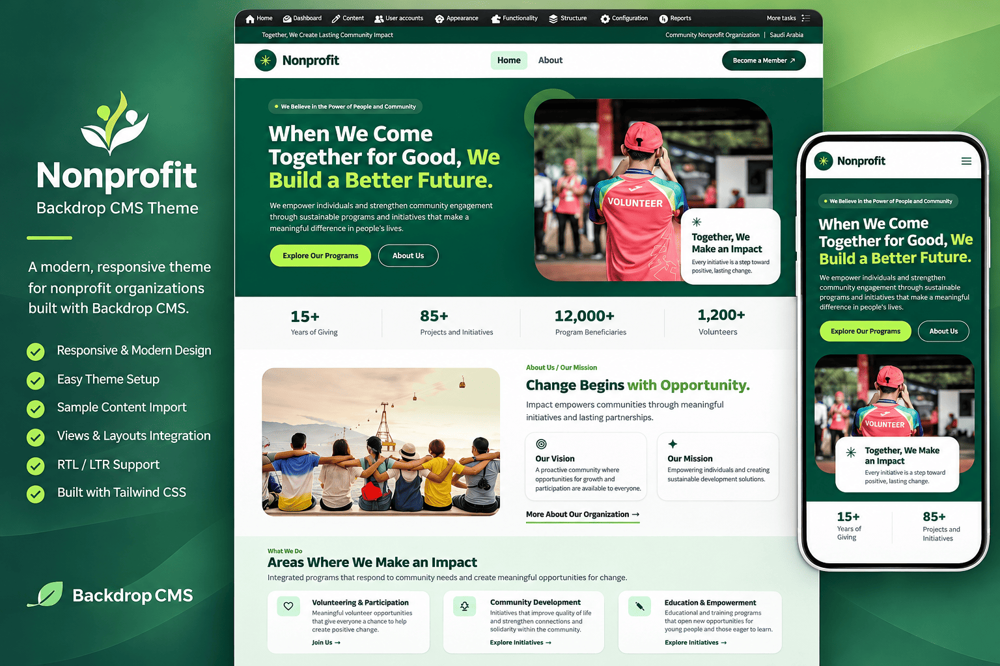

# Nonprofit

**A modern, responsive theme for nonprofit organizations, built for Backdrop CMS.**

Nonprofit provides a welcoming, professional starting point for community organizations, associations, volunteer groups, and other nonprofits. It includes a carefully designed homepage, reusable content sections, and a guided setup process that helps turn a fresh Backdrop installation into a working demonstration site.

## Features

- Responsive design for desktop, tablet, and mobile screens.
- Clean, community-focused design built with Tailwind CSS.
- Support for left-to-right (LTR) and right-to-left (RTL) layouts.
- Homepage sections for a hero message, impact statistics, about/mission, areas of work, initiatives, membership or volunteering, news, and contact information.
- Integration with Backdrop's native Views and Layouts systems.
- Example content, images, taxonomy terms, menus, and custom blocks to help demonstrate the theme.
- A setup workflow that reduces repetitive manual configuration.

## Quick start

1. Install Backdrop CMS and place the **Nonprofit** theme in your site's themes directory.
2. Enable Nonprofit and set it as the default theme under **Appearance**.
3. Open the theme's appearance settings and use the available **Theme Setup** options to import the demonstration configuration and content.
4. Visit the homepage and review the sample sections, then replace the demonstration content, images, links, and organization details with your own.

**Important:** The setup options can create or modify site configuration and content. Use them on a fresh installation or make a backup before running them on an existing site. Review any required contributed modules before starting setup.

## Easy site setup with Backdrop Theme Setup

Nonprofit uses the open-source [Backdrop Theme Setup](https://github.com/shabib-m/backdrop_theme_setup) library to simplify initial site configuration.

Instead of asking users to manually create every content type field, taxonomy term, menu item, View, and Layout block, the theme can describe its demonstration setup in JSON files. The setup library then applies those definitions through Backdrop's existing APIs and configuration system.

Depending on the selected setup options, this can include:

- Enabling required modules before importing dependent configuration.
- Importing field definitions and settings through Backdrop Configuration Management (CMI).
- Creating sample content and importing its images.
- Creating taxonomy terms and menu links.
- Resolving supported references between imported content and taxonomy terms without relying on fixed database IDs.
- Importing Views configuration and placing blocks into Backdrop Layouts.

The goal is simple: **install the theme, run its setup options, and start customizing the site**—without rebuilding the demonstration site by hand.

### Built on Backdrop, not around it

Backdrop Theme Setup is a reusable setup helper, not a replacement for Backdrop's native systems. Nonprofit continues to use Backdrop's Content Types, Fields, Taxonomy, Menus, Views, Layouts, and CMI. The theme controls presentation; Backdrop remains responsible for managing the site's content and configuration.

Theme authors interested in using the same approach in their own projects can explore the library and its documentation:

**[Backdrop Theme Setup on GitHub](https://github.com/shabib-m/backdrop_theme_setup)**

## Customization

After importing the example site, use Backdrop's administration interface to:

- Edit the organization's name, text, images, and contact details.
- Replace the sample initiatives, news, and impact statistics.
- Update navigation menus and button destinations.
- Adjust Views and Layouts to suit your organization's needs.
- Manage content and fields using standard Backdrop tools.

The example content is a starting point, not a requirement for using the theme.

## Intended use

Nonprofit is designed for a broad range of nonprofit and community organizations. It does **not** provide donation processing, payment gateways, or a membership management system. Those functions should be implemented separately using appropriate services or Backdrop modules when needed.

## Contributing

Feedback, bug reports, accessibility improvements, translations, and code contributions are welcome. Please use the GitHub repository's issue tracker and pull requests to help improve the theme.

For improvements to the setup library itself, visit [Backdrop Theme Setup](https://github.com/shabib-m/backdrop_theme_setup).

Current Maintainers
-------------------

- [Shabib M](https://github.com/shabib-m)
- Seeking additional maintainers.

Credits
-------

- Built for [Backdrop CMS](https://backdropcms.org/).

License
-------

This project is GPL v2 software.
See the LICENSE.txt file in this directory for complete text.
